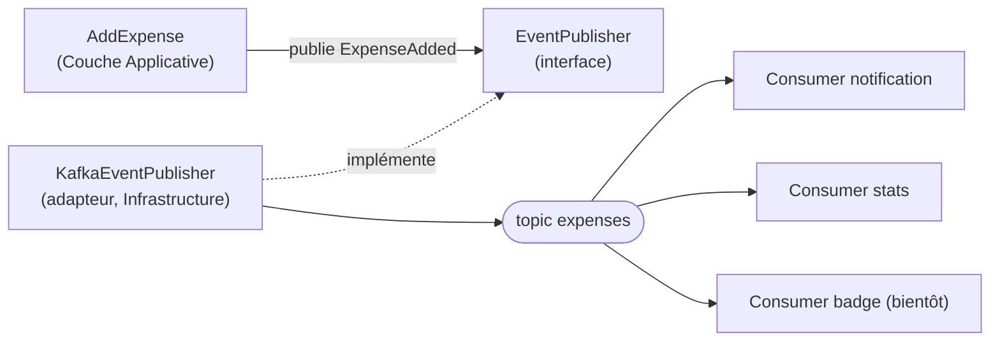

# Mercredi après-midi : réagir à un événement (Kafka)

**Durée** : 3h30 · **En binômes** (4 binômes + 1 trinôme) · **Repo** : le repo de départ commun `seance-5-evenements` (tout le monde part du même code, quel que soit votre avancement de mardi).

**À la fin de l'après-midi, je sais…**

- reconnaître quand un use case doit émettre un événement plutôt qu'appeler lui-même chaque réaction ;
- publier un événement derrière une interface `EventPublisher`, sans que les Couches Domaine et Applicative connaissent Kafka ;
- rendre un consumer idempotent face à un message reçu deux fois ;
- expliquer avec mes mots le problème que résout l'outbox.

---

## 1. Le contexte métier (à lire avant de toucher au code)

### L'appli que vous connaissez

Mardi, vous avez codé une appli de **partage de dépenses entre amis** (comme Tricount) :

- des **groupes** et leurs membres ;
- des **dépenses** : qui a payé, combien, pour qui ;
- des **soldes** : qui doit combien à qui.

Pour aujourd'hui, on a gardé le strict nécessaire : un groupe, ses membres, et des dépenses (qui a payé, combien). Pas de participants ni de soldes dans le repo.

Exemple : le groupe **Week-end Annecy**, avec Alice, Bob et Chloé.

| Dépense | Payée par | Montant |
|---|---|---|
| Gîte | Bob | 240 € |
| **Total du groupe** | | **240 €** |

Ce groupe existe déjà au démarrage de l'API (il est créé dans `src/main.ts`).

### Le besoin évolue

L'équipe produit veut que l'appli **réagisse** quand une dépense est ajoutée :

1. **Prévenir les autres membres** : « Alice a ajouté 60 € ».
2. **Mettre à jour les statistiques du groupe** : le total dépensé.
3. **Bientôt, attribuer des badges** : par exemple « Badge gros dépensier » au-delà de 100 €.

### Un exemple chiffré

Alice ajoute **« Courses, 60 € »** dans le groupe *Week-end Annecy*. Il doit se passer trois choses :

| Réaction | Ce qu'on attend |
|---|---|
| Notification | Bob et Chloé reçoivent « Alice a ajouté 60 € » (pas Alice : c'est elle qui l'a ajoutée). |
| Statistiques | Le total du groupe passe de **240 €** à **300 €**. |
| Badge (bientôt) | Rien pour cette dépense : 60 €, c'est moins de 100 €. |

### Pourquoi le code actuel va souffrir

Aujourd'hui, le use case `AddExpense` fait tout lui-même : il enregistre la dépense, **puis** appelle le `Notifier`, **puis** `GroupStats` (deux interfaces de la Couche Applicative, avec leurs adapteurs `ConsoleNotifier` et `ConsoleGroupStats` dans `src/infrastructure/console/`).

- Chaque nouvelle réaction (le badge, puis la suivante…) oblige à **rouvrir `AddExpense`**, son constructeur et son test.
- Si la notification plante, **Alice voit une erreur**, alors que sa dépense, elle, est bien là.
- `AddExpense` devait « ajouter une dépense ». Il est devenu le chef d'orchestre de tout le produit.

Cet après-midi, on passe directement à la bonne pratique : `AddExpense` va annoncer simplement « une dépense a été ajoutée », et ne plus connaître aucune de ses réactions (A, B). Puis on rend le consumer robuste aux doublons (C).



### Vocabulaire du jour (3 mots, pas plus)

| Mot | Définition |
|---|---|
| **Topic** | Une boîte aux lettres nommée, dans Kafka. Ici : `expenses`. |
| **Producer** | Celui qui dépose un message dans le topic. Ici : `KafkaEventPublisher`. |
| **Consumer** | Celui qui lit les messages du topic, à son rythme. Ici : `notification-consumer`. |

Et l'idée clé : **un événement est un fait passé** (`ExpenseAdded` : « une dépense a été ajoutée »), pas un ordre (`SendNotification` : « envoie une notification »). Celui qui publie ne sait pas qui écoute.

---

## 2. Setup collectif (10 min, tous ensemble)

> **Besoin servi** : que Kafka tourne chez tout le monde avant de commencer.

1. Clonez le repo de départ, puis lancez `npm install`.
2. Créez le conteneur : `docker compose up -d --wait` (environ 10 s ; le conteneur `depenses-kafka-init` s'arrête tout seul, c'est normal).
3. Ouvrez `http://localhost:8080` : le cluster Kafka est vert.
4. Lancez `npm test` : le test `add-expense.test.ts` est vert.

Les autres tests sont **rouges** ou **en pause** (skipped) au départ : c'est normal, c'est vous qui allez les faire passer.

> ✅ **Vous avez fini quand…** l'interface Kafka s'ouvre dans votre navigateur et `add-expense.test.ts` est vert.

💡 Docker refuse de démarrer ? Levez la main : un Kafka de secours tourne sur le réseau de la salle.

Créez dès maintenant un fichier `REPONSES.md` à la racine du repo, avec trois titres : `## A`, `## B`, `## C`. Vos réponses écrites iront dedans.

---

## 3. Passage à la pratique !

### A. Introduire l'interface `EventPublisher` (45 min + 10 min de correction)

> **Besoin servi** : pouvoir ajouter une réaction (le badge, et les suivantes) **sans rouvrir `AddExpense`**.

**Exemple résolu** (déjà dans le repo, montré au tableau) : le type de l'événement et l'interface.

```ts
// Couche Applicative · src/application/events.ts
export type ExpenseAdded = {
  type: "ExpenseAdded";
  eventId: string;
  groupId: string;
  payerName: string;
  amountInCents: number;
  occurredAt: string;
};

export interface EventPublisher {
  publish(event: ExpenseAdded): Promise<void>;
}
```

> **Mini-rappel TypeScript**
> - `type ExpenseAdded = { … }` décrit la **forme des données** : un objet qui a ces champs-là, avec ces types-là.
> - `interface EventPublisher { … }` décrit un **contrat** : toute classe qui écrit `implements EventPublisher` doit avoir une méthode `publish(event)` qui renvoie une `Promise<void>`.
> - Recevoir une dépendance par le constructeur : `constructor(private readonly publisher: EventPublisher) {}`, comme vous l'avez fait mardi avec `GroupRepository`.

1. Complétez la méthode `publish` de `InMemoryEventPublisher` (`src/infrastructure/events/in-memory-event-publisher.ts`) : elle range l'événement reçu dans le tableau `published`. (La classe, sa signature et le test rouge sont fournis.)
2. Lancez `npm test` : le test `in-memory-event-publisher.test.ts` passe au vert.
3. Modifiez `AddExpense` : retirez `Notifier` et `GroupStats` du constructeur, et recevez à la place un `EventPublisher`.
4. Publiez un `ExpenseAdded` dans `AddExpense`, juste **après** l'enregistrement du groupe (`save`).
5. Activez le test déjà réécrit pour vous, `tests/application/add-expense.etape-b.test.ts`, en suivant le mode d'emploi en tête du fichier, puis lancez `npm test` : il passe au vert.
6. Dans `src/main.ts`, donnez un `new InMemoryEventPublisher()` à `AddExpense`, à la place de `ConsoleNotifier` et `ConsoleGroupStats`.
7. Vérifiez qu'aucun fichier de `src/domain` ni de `src/application` n'importe quoi que ce soit depuis `src/infrastructure`.

> ✅ **Vous avez fini quand…** les deux tests et `npm run typecheck` sont verts, et `AddExpense` n'importe plus ni `Notifier` ni `GroupStats`.

🤖 **IA** : autorisée pour la question 1. Les questions 3 et 4 sont à faire **à la main** : c'est le geste du jour.

💡 Dans `REPONSES.md`, sous `## A`, répondez en une ligne : où vivent maintenant la notification, les stats et le badge ?

---

*Pause (10 min)*

---

### B. Brancher Kafka (55 min + 10 min de correction)

> **Besoin servi** : Bob et Chloé reçoivent **vraiment** la notification « Alice a ajouté 60 € », et le badge pourra s'ajouter sans toucher au use case.

Fourni : `KafkaEventPublisher` (la connexion `kafkajs` est déjà écrite) et un consumer complet, `src/consumers/notification-consumer.ts`.

Le snippet dont vous avez besoin pour la question 1 (`TOPIC` vaut `"expenses"`, il est déjà importé) :

```ts
// Couche Infrastructure · kafka-event-publisher.ts
await this.producer.send({
  topic: TOPIC,
  messages: [{ value: JSON.stringify(event) }],
});
```

1. Complétez la méthode `publish` de `KafkaEventPublisher` avec ce snippet.
2. Dans `src/main.ts`, remplacez `new InMemoryEventPublisher()` par `new KafkaEventPublisher()` (une seule ligne change, plus l'import).
3. Ajoutez la dépense « Courses, 60 € » avec la requête fournie dans `requests.http` (l'API doit tourner : `npm run dev`).
4. Retrouvez votre message dans kafka-ui (`http://localhost:8080`), topic `expenses`.
5. Lancez le consumer dans un 2e terminal : `npm run consumer:notification`. La notification s'affiche.
6. Arrêtez le consumer avec **Ctrl+C**, ajoutez 3 dépenses, puis relancez-le. Notez ce qui se passe.
7. Répondez : pour ajouter le badge maintenant, quel fichier faut-il créer ou modifier ?

> ✅ **Vous avez fini quand…** une dépense ajoutée par l'API produit une notification dans le terminal du consumer, et vos réponses 6 et 7 sont dans `REPONSES.md`.

🤖 **IA** : utile pour comprendre le consumer fourni (« explique-moi ce fichier ligne à ligne »). Ne le faites pas réécrire : lisez-le.

---

### C. Recevoir deux fois le même message (bonus, 30 min)

*Bloc bonus : à faire une fois B terminé.*

> **Besoin servi** : Bob ne doit **pas** recevoir deux fois « Alice a ajouté 60 € » pour la même dépense.

Contexte : Kafka garantit qu'un message arrive **au moins une fois**, pas **exactement une fois**. Un même message peut donc arriver deux fois (le consumer a planté juste avant de confirmer, le réseau a coupé…). C'est pour ça que chaque événement porte un `eventId` unique.

> **Mini-rappel TypeScript : `Set`**
> ```ts
> const seen = new Set<string>();
> seen.add("evt-1");
> seen.has("evt-1"); // true
> seen.has("evt-2"); // false
> seen.add("evt-1"); // déjà là : rien ne change
> seen.size;         // 1
> ```
> Un `Set`, c'est une liste sans doublons, avec `has` pour demander « déjà vu ? ».

1. Lancez `npm run replay` (script fourni : il republie le dernier message).
2. Notez dans `REPONSES.md` ce qu'affiche le consumer.
3. Complétez la classe `ProcessedEvents` fournie : ses méthodes `has(eventId)` et `add(eventId)`, avec un `Set` en mémoire. (Test rouge fourni.)
4. Modifiez la fonction `handle` du consumer : si l'`eventId` a déjà été traité, elle ignore le message. Créez `const processed = new ProcessedEvents()` **en haut du fichier**, pas dans `handle` (sinon le `Set` repart à zéro à chaque message).
5. Relancez `npm run replay` : la notification ne s'affiche plus qu'une fois.

> ✅ **Vous avez fini quand…** le test `processed-events.test.ts` est vert, et le replay ne produit plus de doublon.

🤖 **IA** : elle peut vous réexpliquer `Set`. Le `if` du consumer (question 4), c'est vous.

💡 Question pour la fin : si le consumer redémarre, le `Set` est vide… Que se passe-t-il alors ? (On en reparle avec une vraie base.)

---

### Bonus (pour les binômes en avance)

> **Besoin servi** : ne **jamais** perdre une notification, même quand Kafka ou un consumer a un problème.

**Bonus 1 : outbox guidée.**
1. Complétez `InMemoryOutbox` (`src/infrastructure/outbox/in-memory-outbox.ts`) : `publish`, `pending` et `markAsSent`.
2. Complétez `relayOnce` dans `OutboxRelay` : il publie chaque événement en attente, puis le marque comme envoyé.
3. Lancez les tests : ils passent au vert.

**Bonus 2 : DLQ (dead-letter queue).**
1. Complétez `handleWithRetry` (`src/consumers/retry-or-dead-letter.ts`) : elle essaie la réaction jusqu'à 3 fois, puis envoie le message dans la DLQ. (Test rouge fourni.)
2. Branchez-la dans le consumer de notification, avec une réaction qui plante sur les dépenses à 0 €.
3. Envoyez la requête « Café offert, 0 € » de `requests.http`, puis retrouvez le message dans le topic `expenses.dlq` de kafka-ui.

**Bonus 3 : IA critique.**
1. Demandez à l'IA « ajoute Kafka à ce projet » sur le code de départ.
2. Listez chaque endroit où elle a fait importer `kafkajs` dans la Couche Applicative.
3. Expliquez, pour chacun, quelle règle des dépendances est violée.

> ✅ **Vous avez fini quand…** (bonus 1) `tests/bonus/outbox.test.ts` est vert ; (bonus 2) le message apparaît dans `expenses.dlq` ; (bonus 3) votre liste est dans `REPONSES.md`.

---

## 4. Démo de fin : et si Kafka tombe ? (formateur, 10 min)

Le formateur arrête Kafka, puis ajoute une dépense. L'API mouline une dizaine de secondes, puis répond une erreur… alors que la dépense est bien enregistrée. Alice va réessayer (doublon), et l'événement, lui, est **perdu** : Bob ne sera jamais prévenu.

Retenez la solution, l'**outbox** : on écrit l'événement **dans la même base et dans la même transaction** que la dépense, dans une table `outbox`. Un relais le publie ensuite vers Kafka. Si Kafka est arrêté, l'événement attend dans l'outbox.

---

## Pour aller plus loin

- Martin Fowler, [What do you mean by “Event-Driven”?](https://martinfowler.com/articles/201701-event-driven.html) : « événement » veut dire plusieurs choses. Ce qu'on a fait aujourd'hui s'appelle *Event Notification*.
- Chris Richardson, [Pattern: Transactional outbox](https://microservices.io/patterns/data/transactional-outbox.html) (microservices.io) : le schéma de la démo de fin.
- [Introduction to Apache Kafka](https://kafka.apache.org/intro) : la doc officielle.
- Robert C. Martin, [The Clean Architecture](https://blog.cleancoder.com/uncle-bob/2012/08/13/the-clean-architecture.html) : Kafka est un détail d'Infrastructure, comme la base de données.
