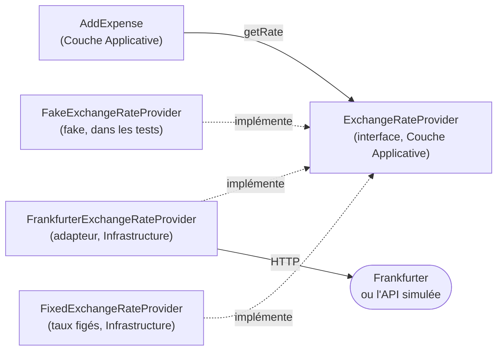

# Jeudi matin : brancher une API externe sans polluer le Domaine

**Durée** : 3h30 · **En binômes** · **Repo** : le repo de départ commun `seance-6-devises` (tout le monde part du même code, quel que soit votre avancement de mardi).

**À la fin de la matinée, je sais…**

- traduire la réponse d'une API externe en objet de mon Domaine, dans un adapteur ;
- tester un use case qui dépend d'une API externe, pannes comprises, grâce à un **fake** ;
- protéger mon application d'une API lente ou en panne (timeout, retry), sans que le use case le sache.

---

## 1. Le contexte métier (à lire avant de toucher au code)

### L'appli que vous connaissez

Mardi, vous avez codé une appli de **partage de dépenses entre amis** (comme Tricount) : des **groupes**, des **dépenses** (qui a payé, combien, pour qui) et des **soldes** (qui doit combien). Ce repo est le corrigé de mardi, avec quelques fichiers en plus pour aujourd'hui.

Tous les montants du groupe sont en **euros**, et toujours en **centimes** : `3000` veut dire 30,00.

### Le besoin évolue

Alice et Bob partent en week-end à New York. Alice paie le resto : **30 $**. Le groupe *Week-end à New York* (Alice, Bob) existe déjà au démarrage de l'API : il est créé dans `src/main.ts`. Le groupe compte en euros : il faut donc **convertir 30 $ en euros** avant d'ajouter la dépense au groupe.

Pour connaître le taux du jour, on va utiliser une **API externe** gratuite : **Frankfurter** (https://frankfurter.dev/).

### Un exemple chiffré

Si 1 $ vaut 0,90 € :

| Étape | Valeur |
|---|---|
| Alice paie le resto | 30 $ (`amountCents: 3000`, `currency: 'USD'`) |
| On demande le taux USD → EUR | 0,9 |
| On convertit : 3000 × 0,9 | 2700 centimes = **27 €** |
| On partage entre Alice et Bob | Bob doit **13,50 €** à Alice |

Le calcul « montant × taux » est déjà écrit pour vous dans le Domaine : la classe `ExchangeRate` (`src/domain/exchange-rate.ts`), avec sa méthode `convert`.

### La règle du jour

Frankfurter a **son** format de réponse (un JSON avec ses noms de champs, ses codes HTTP). Notre appli a **ses** objets (`ExchangeRate`, `UnknownCurrencyError`…). Un seul fichier a le droit de connaître Frankfurter : **l'adapteur**. Il **traduit** leur JSON en nos objets. Si Frankfurter change demain, on ne touche qu'à ce fichier.



### Vocabulaire du jour

| Mot | Définition |
|---|---|
| **Adapteur** | La classe qui parle à l'API externe et traduit sa réponse. Ici : `FrankfurterExchangeRateProvider`. |
| **Fake** | Une petite classe **en mémoire** qui implémente la même interface, pour les **tests**. Aucun réseau. Ici : `FakeExchangeRateProvider`. |
| **Taux figés** | `FixedExchangeRateProvider` : un adapteur fourni, avec des taux écrits en dur. Il fait tourner l'appli avant qu'on ait écrit l'adapteur Frankfurter. |
| **API simulée** | Un petit **serveur local** (`tools/api-simulee.ts`) qui imite Frankfurter, et qu'on peut rendre lent ou en panne exprès. C'est un vrai serveur HTTP, pas un fake. |
| **Timeout** | « Si l'API n'a pas répondu au bout de 2 s, j'abandonne. » |
| **Retry avec backoff** | « Si l'API a échoué, je réessaie, en attendant un peu plus longtemps à chaque fois. » |

### Ce qui est déjà dans le repo

| Fichier | Couche | État |
|---|---|---|
| `src/domain/exchange-rate.ts` | Domaine | ✅ fourni : `ExchangeRate` et `convert` |
| `src/domain/unknown-currency-error.ts` | Domaine | ✅ fourni : l'erreur « devise inconnue » |
| `src/application/exchange-rate-provider.ts` | Applicative | ✅ fourni : l'interface `ExchangeRateProvider` |
| `src/application/exchange-rate-unavailable-error.ts` | Applicative | ✅ fourni : l'erreur « taux indisponible » |
| `src/application/add-expense.ts` | Applicative | ✏️ **à compléter** (bloc A : la méthode `toEurCents`) |
| `tests/application/fake-exchange-rate-provider.ts` | tests | ✏️ **à compléter** (bloc A) |
| `src/infrastructure/exchange-rates/fixed-exchange-rate-provider.ts` | Infrastructure | ✅ fourni : un adapteur à taux **figés** (1 $ = 0,90 €), pour faire tourner l'appli avant le bloc B |
| `src/infrastructure/exchange-rates/frankfurter-exchange-rate-provider.ts` | Infrastructure | ✏️ **à compléter** (blocs B, C, D) |
| `tools/api-simulee.ts` | outil | ✅ fourni : l'API simulée |

L'interface, déjà écrite pour vous :

```ts
// Couche Applicative · src/application/exchange-rate-provider.ts
export interface ExchangeRateProvider {
  getRate(base: string, quote: string): Promise<ExchangeRate>;
}
```

`base` est la devise de départ (`'USD'`), `quote` la devise d'arrivée (`'EUR'`).

---

## 2. Setup collectif (10 min, tous ensemble)

> **Besoin servi** : que tout le monde ait le projet qui tourne avant de commencer.

1. Clonez le repo de départ.
2. Lancez `npm install`.
3. Lancez `npm test`.
4. Vérifiez le résultat : **9 tests rouges**, tous les autres verts, et 1 test « todo » (un test que vous écrirez vous-même au bloc A).
5. Créez un fichier `REPONSES.md` à la racine du repo, avec cinq titres : `## A`, `## B`, `## C`, `## D`, `## Bonus`.

Les 9 tests rouges sont **normaux** : ils attendent votre code. Le nom de chaque test commence par le bloc qui le fait passer (`Bloc A · …`, `Bloc B · …`).

Voyez maintenant le problème du jour :

6. Lancez l'API : `npm run dev`.
7. Envoyez la requête « Resto à New York, 30 $ » de `requests.http` : réponse **201**.
8. Envoyez la requête « Soldes du groupe New York » : Bob doit **15 €** à Alice. Les 30 $ sont comptés comme 30 €, au lieu de 27 €.

> ✅ **Vous avez fini quand…** `npm test` affiche 9 tests rouges, vous avez vu « Bob doit 15 € » (`-1500`), et `REPONSES.md` existe.

---

## 3. Passage à la pratique !

### A. Convertir dans le use case, et le tester avec un fake (45 min + 10 min de correction)

> **Besoin servi** : quand Alice ajoute 30 $, le groupe reçoit 27 €. Et on veut le **tester sans réseau** : un test qui dépend d'Internet échoue quand le wifi tombe.

On commence par l'intérieur, comme mardi : la Couche Applicative. Pour l'instant, les taux sont **figés** (1 $ = 0,90 €). La vraie API arrive au bloc B.

**Exemple résolu** (vous le connaissez depuis mardi, il est dans `tests/application/add-expense.test.ts`) : le fake du repository.

```ts
class FakeGroupRepository implements GroupRepository {
  saved: Group[] = [];
  constructor(private readonly group?: Group) {}
  async findById(id: string) {
    return this.group?.id === id ? this.group : undefined;
  }
  async save(group: Group) {
    this.saved.push(group);
  }
}
```

Un fake **implémente la même interface** que le vrai adapteur, mais garde tout en mémoire. Vous allez faire pareil pour `ExchangeRateProvider`.

> **Mini-rappel TypeScript**
> - `Record<string, number>` : un objet dont les clés sont des textes et les valeurs des nombres. Exemple : `const rates = { USD: 0.9, GBP: 1.15 }`.
> - `rates['USD']` vaut `0.9` ; `rates['XYZ']` vaut `undefined` (la clé n'existe pas).

1. Ouvrez `tests/application/fake-exchange-rate-provider.ts`.
2. Complétez la méthode `getRate` de `FakeExchangeRateProvider` en suivant les 3 étapes écrites en commentaire.
3. Ouvrez `src/application/add-expense.ts` et complétez la méthode `toEurCents`, tout en bas du fichier : remplacez la ligne `return amountCents; // ← provisoire…` en suivant les consignes en commentaire au-dessus :
   - si la devise est `'EUR'`, renvoyez le montant tel quel ;
   - sinon, demandez le taux de `currency` vers `'EUR'` à `this.exchangeRates` (sans oublier `await` : `getRate` renvoie une `Promise`), puis renvoyez `rate.convert(amountCents)`.
4. Lancez `npm test` : les tests `Bloc A · …` passent au vert.
5. Complétez la classe `BrokenExchangeRateProvider` (même fichier que le fake) : sa méthode `getRate` lève une `ExchangeRateUnavailableError`.
6. Écrivez le test `ne sauvegarde rien si le fournisseur de taux échoue` dans `tests/application/add-expense-devises.test.ts` (le mode d'emploi est en commentaire au-dessus du `it.todo`).
7. Lancez `npm test` : les 4 tests de `add-expense-devises.test.ts` sont verts, le vôtre compris.

**Essayez pour de vrai** (l'appli utilise les taux figés de `FixedExchangeRateProvider`, branché dans `src/main.ts`) :

8. Relancez la requête « Resto à New York, 30 $ » de `requests.http` (l'API doit tourner : `npm run dev`).
9. Envoyez la requête « Soldes du groupe New York » : Bob doit maintenant **13,50 €** à Alice, plus 15 €.

> ✅ **Vous avez fini quand…** les 4 tests de `add-expense-devises.test.ts` sont verts (le vôtre compris), et la requête des soldes affiche 13,50 € (`1350`).

🤖 **IA** : autorisée pour la question 6 si vous bloquez sur la syntaxe du test. Les questions 2 et 3 sont à faire **à la main**.

💡 Dans `REPONSES.md`, sous `## A` : les tests du bloc A appellent-ils Frankfurter ? Comment le savez-vous ?

---

*Pause (10 min)*

---

### B. Écrire l'adapteur Frankfurter, et le brancher (55 min + 10 min de correction)

> **Besoin servi** : utiliser le **vrai** taux du jour, donné par Frankfurter, sous la forme d'un `ExchangeRate` (notre objet), et jamais sous la forme de leur JSON.

On travaille dans **un seul fichier** : `src/infrastructure/exchange-rates/frankfurter-exchange-rate-provider.ts`. Puis on change **une ligne** de `src/main.ts`.

#### Étape 1 : lire la doc (15 min)

Une vraie compétence de dev : trouver l'information dans la doc d'une API, sans tutoriel.

1. Ouvrez la doc : https://frankfurter.dev/
2. Trouvez la section **Rate** (au singulier). Recopiez dans `REPONSES.md` l'URL qui donne le taux pour **une seule paire de devises**.
3. Adaptez cette URL pour obtenir le taux **USD → EUR**, puis ouvrez-la dans votre navigateur.
4. Recopiez dans `REPONSES.md` la réponse JSON affichée, puis écrivez à côté de chaque champ son type (`string` ou `number`).
5. Trouvez la section **Errors** de la doc. Notez le code HTTP renvoyé pour une devise qui n'existe pas.
6. Vérifiez-le : ouvrez `https://api.frankfurter.dev/v2/rate/usd/xyz` dans votre navigateur (ou utilisez la requête prête dans `requests.http`).

💡 La doc montre la commande, pas la réponse : c'est fréquent. Le réflexe : **appeler l'API soi-même** et regarder.

#### Étape 2 : coder la traduction (30 min)

**Exemple résolu** : un adapteur pour une autre API (une API de météo imaginaire). Lisez-le : vous allez faire la même chose pour Frankfurter.

```ts
// La forme du JSON de l'API météo : LEUR modèle (pas exporté).
type MeteoResponse = {
  city: string;
  temp_c: number;
};

// Dans l'adapteur :
private async fetchTemperature(city: string): Promise<Temperature> {
  // 1. Appeler l'API
  const response = await fetch(`${this.baseUrl}/weather/${city}`);

  // 2. Traduire les codes HTTP en NOS erreurs
  if (response.status === 404) {
    throw new UnknownCityError(city);                       // erreur du Domaine
  }
  if (!response.ok) {                                        // tout autre code d'erreur (500, 503…)
    throw new WeatherUnavailableError(`HTTP ${response.status}`);
  }

  // 3. Lire le JSON, puis le traduire en NOTRE objet du Domaine
  const data = (await response.json()) as MeteoResponse;
  return new Temperature(data.city, data.temp_c);
}
```

> **Mini-rappel TypeScript**
> - `type X = { champ: string; autre: number }` décrit la **forme** d'un objet.
> - `await fetch(url)` envoie une requête HTTP GET et renvoie une `Response`. `response.status` est le code HTTP (200, 422…), `response.ok` vaut `true` si le code est entre 200 et 299.
> - `(await response.json()) as MeteoResponse` lit le corps JSON et dit à TypeScript « fais-moi confiance, il a cette forme-là ».
> - `` `${this.baseUrl}/weather/${city}` `` : une chaîne avec des variables dedans (backticks, pas des apostrophes).

1. Complétez le type `FrankfurterRateResponse` avec les 4 champs notés à l'étape 1, et leur type.
2. Dans la méthode `fetchRate`, remplacez la ligne `throw new Error('À implémenter (bloc B)');` par un appel à l'URL `` `${this.baseUrl}/rate/${base}/${quote}` `` avec `fetch`.
3. Ajoutez la traduction du code **422** en `UnknownCurrencyError` (passez-lui `base`).
4. Ajoutez la traduction de **tout autre code d'erreur** en `ExchangeRateUnavailableError`.
5. Ajoutez la lecture du JSON et renvoyez un `new ExchangeRate(…)` construit à partir de ses champs.
6. Lancez `npm test` : les 3 tests `Bloc B · …` passent au vert. Le test `Bloc D · ne réessaie pas une devise inconnue` passe aussi au vert : c'est normal, il doit le rester.
7. Lancez `npm run typecheck` : aucune erreur.

Dans les tests, `this.baseUrl` vaut l'adresse de l'API simulée (un petit serveur local, on le découvre au bloc C) : l'adapteur ne sait pas à qui il parle.

#### Étape 3 : brancher l'adapteur (10 min)

C'est le geste de mercredi : on change d'adapteur dans la **composition root**, sans toucher au use case.

8. Dans `src/main.ts`, **ligne 20**, remplacez le fournisseur à taux figés par l'adapteur Frankfurter :

   Avant :
   ```ts
     const exchangeRates = new FixedExchangeRateProvider(); // ← partie B : remplacer par new FrankfurterExchangeRateProvider(EXCHANGE_API_URL)
   ```
   Après :
   ```ts
     const exchangeRates = new FrankfurterExchangeRateProvider(EXCHANGE_API_URL);
   ```
   `EXCHANGE_API_URL` (ligne 15) vaut `'https://api.frankfurter.dev/v2'` : c'est la vraie API.
9. Relancez la requête « Resto à New York, 30 $ » de `requests.http` : réponse **201**.
10. Envoyez la requête « Soldes du groupe New York » : Bob doit environ 13,50 € à Alice, au taux du jour (pas exactement 0,9).
11. Envoyez la requête « devise inconnue » : réponse **400** et `Devise inconnue : XYZ`.

💡 `npm run dev` redémarre tout seul quand vous enregistrez un fichier : les dépenses en mémoire repartent de zéro.

> ✅ **Vous avez fini quand…** les 3 tests `Bloc B · …` et `npm run typecheck` sont verts, la dépense en dollars est convertie au taux du jour, et les réponses de l'étape 1 sont dans `REPONSES.md`.

🤖 **IA** : interdite pour l'étape 1 (c'est vous qui lisez la doc). Pour l'étape 2, elle peut vous réexpliquer `fetch`. Écrivez la traduction vous-même.

💡 Dans `REPONSES.md`, sous `## B` :
- Si Frankfurter renomme demain son champ `rate` en `value`, quel(s) fichier(s) faut-il modifier ?
- Pour passer des taux figés à la vraie API, avez-vous modifié `AddExpense` ?

---

### C. Basculer sur l'API simulée, et ajouter un timeout (30 min + 5 min de correction)

> **Besoin servi** : si Frankfurter met 30 secondes à répondre, Alice ne doit pas attendre 30 secondes devant un écran figé. Au bout de 2 s, on abandonne et on lui dit « réessayez plus tard ».

On ne peut pas rendre Frankfurter lent exprès. On va donc utiliser l'**API simulée** : un petit serveur sur votre machine, qui répond comme Frankfurter, mais qu'on peut rendre lent ou en panne.

#### Étape 1 : basculer (10 min)

1. Lancez l'API simulée dans un **2e terminal** : `npm run api-simulee`.
2. Ouvrez http://localhost:4000/v2/rate/USD/EUR dans votre navigateur : même JSON que Frankfurter (avec un taux fixe de 0,9).
3. Dans `src/main.ts`, **ligne 15**, remplacez l'adresse de l'API :

   Avant :
   ```ts
   const EXCHANGE_API_URL = 'https://api.frankfurter.dev/v2'; // ← partie C : remplacer par 'http://localhost:4000/v2'
   ```
   Après :
   ```ts
   const EXCHANGE_API_URL = 'http://localhost:4000/v2'; // ← partie C : remplacer par 'http://localhost:4000/v2'
   ```
4. Relancez la requête « Resto à New York, 30 $ » de `requests.http`. Vérifiez dans le terminal de l'API simulée qu'elle a bien reçu la requête.

💡 Une seule ligne a changé, dans `main.ts`. Ni l'adapteur, ni `AddExpense`, ni le Domaine n'ont bougé.

#### Étape 2 : rendre l'API lente, puis ajouter le timeout (20 min)

5. Arrêtez l'API simulée (**Ctrl+C**), puis relancez-la en mode lent : `npm run api-simulee:lente` (elle répond en 3 s).
6. Envoyez la requête « Resto à New York, 30 $ ». Notez dans `REPONSES.md` combien de temps elle met.
7. Ajoutez le timeout dans `fetchRate` : donnez une option `signal` à `fetch`, comme ceci.

   ```ts
   const response = await fetch(url, { signal: AbortSignal.timeout(TIMEOUT_MS) });
   ```
   `TIMEOUT_MS` vaut 2000 (2 s), il est déjà déclaré en haut du fichier. Au bout de 2 s, `fetch` **lève une erreur**.
8. Entourez l'appel à `fetch` d'un `try … catch`, pour traduire **n'importe quelle erreur** de `fetch` en `ExchangeRateUnavailableError`.

   > **Mini-rappel TypeScript : déclarer avant le `try`**
   > ```ts
   > let response: Response;           // déclarée ici, pour être utilisable APRÈS le try
   > try {
   >   response = await fetch(…);
   > } catch (error) {
   >   throw new ExchangeRateUnavailableError(String(error));
   > }
   > // ici, on peut utiliser response
   > ```
9. Lancez `npm test` : les 2 tests `Bloc C · …` passent au vert.
10. Renvoyez la requête « Resto à New York, 30 $ » : réponse **503** au bout de 2 s.
11. Arrêtez l'API simulée (**Ctrl+C**) et renvoyez la requête : réponse **503** tout de suite (personne ne répond).

> ✅ **Vous avez fini quand…** les tests `Bloc C · …` sont verts, et l'appli répond 503 en 2 s maximum quand l'API simulée est lente ou arrêtée.

🤖 **IA** : autorisée pour comprendre `AbortSignal.timeout`. Le `try … catch`, c'est vous.

💡 Dans `REPONSES.md`, sous `## C` : avant le timeout, que se passait-il quand l'API simulée était arrêtée ? Quel code HTTP Alice recevait-elle ?

---

### D. Réessayer quand l'API est en panne (si vous avez le temps, 30 min)

*À faire une fois C terminé. Sinon, le formateur le montre en fin de matinée.*

> **Besoin servi** : une API qui échoue **de temps en temps** (une requête sur deux, par exemple) ne doit pas faire échouer Alice. On réessaie, sans que le use case `AddExpense` le sache.

1. Relancez l'API simulée en mode panne : `npm run api-simulee:en-panne` (une requête sur deux répond 500).
2. Envoyez 4 fois la requête « Resto à New York, 30 $ ». Notez les codes de réponse dans `REPONSES.md`.
3. Dans `getRate`, remplacez `return this.fetchRate(base, quote);` par une boucle qui :
   - appelle `this.fetchRate(base, quote)`, et renvoie le résultat si ça marche ;
   - si l'erreur est une `ExchangeRateUnavailableError` et qu'il reste des essais : attend (`await wait(delay)`), double `delay`, puis réessaie ;
   - sinon, relance l'erreur (`throw error`).

   Les constantes `MAX_ATTEMPTS` (3 essais) et `FIRST_RETRY_DELAY_MS` (200 ms), et la fonction `wait`, sont déjà dans le fichier. Attentes : 200 ms, puis 400 ms. C'est ça, le **backoff**.

   Le squelette, à compléter :
   ```ts
   let delay = FIRST_RETRY_DELAY_MS;
   for (let attempt = 1; attempt <= MAX_ATTEMPTS; attempt++) {
     try {
       return await this.fetchRate(base, quote);
     } catch (error) {
       // À vous : relancer l'erreur si ce n'est pas une ExchangeRateUnavailableError,
       // ou si c'était le dernier essai. Sinon : attendre, puis doubler delay.
     }
   }
   throw new Error('Impossible d\'arriver ici');
   ```
4. Lancez `npm test` : les 2 tests `Bloc D · …` sont verts.
5. Renvoyez 4 fois la requête : 4 réponses **201**. Regardez le terminal de l'API simulée : elle a reçu 8 requêtes.

> ✅ **Vous avez fini quand…** les tests `Bloc D · …` sont verts, et 4 requêtes de suite répondent 201 avec l'API simulée en panne.

💡 Dans `REPONSES.md`, sous `## D` :
- Pourquoi ne réessaie-t-on **pas** une devise inconnue (422) ?
- Avez-vous modifié `AddExpense` pour ajouter le retry ? Pourquoi ?

---

### Bonus (pour les binômes en avance)

**Bonus 1 : health check.**
1. Ajoutez une route `GET /health` qui appelle `getRate('USD', 'EUR')`.
2. Faites-la répondre **200** `{"status":"ok"}` si le taux arrive, et **503** `{"status":"indisponible"}` sinon.
3. Testez-la avec l'API simulée lancée, puis arrêtée (Ctrl+C).

**Bonus 2 : circuit breaker.** Si l'API a échoué 3 fois de suite, on ne l'appelle plus pendant 10 s : on lève directement une `ExchangeRateUnavailableError`.
1. Créez une classe `CircuitBreakerExchangeRateProvider` dans `src/infrastructure/exchange-rates/`, qui implémente `ExchangeRateProvider` et reçoit un autre `ExchangeRateProvider` dans son constructeur.
2. Branchez-la dans `src/main.ts`, autour de l'adapteur Frankfurter.
3. Arrêtez l'API simulée (Ctrl+C), puis envoyez 4 fois la requête « Resto à New York, 30 $ » : à partir de la 4e, la réponse 503 arrive tout de suite.
4. Relancez `npm run api-simulee` et renvoyez la requête aussitôt : le terminal de l'API simulée ne reçoit rien pendant 10 s.

**Bonus 3 : mesurer.** (il faut le bonus 1)
1. Lancez l'API simulée normale (`npm run api-simulee`) et l'appli (`npm run dev`).
2. Dans un 3e terminal, lancez cette commande (10 utilisateurs en même temps pendant 10 s) :
   ```bash
   npx autocannon -c 10 -d 10 http://localhost:3000/health
   ```
3. Notez dans `REPONSES.md` le nombre de requêtes par seconde (`Req/Sec`) et la latence moyenne (`Latency`, colonne `Avg`).
4. Recommencez avec l'API simulée lente (`npm run api-simulee:lente`), puis comparez.

**Bonus 4 : passer à la v1 de Frankfurter** (dès que B est fini, 20 min)

> **Besoin servi** : vérifier par vous-même que, si l'API externe change, **seul l'adapteur** bouge.

Frankfurter a une ancienne version, la **v1**, qui répond avec un autre JSON. Vous allez écrire un 2e adapteur pour elle.

1. Lisez la doc v1 (https://frankfurter.dev/v1/) : trouvez l'URL du dernier taux USD → EUR.
2. Ouvrez cette URL dans votre navigateur, puis recopiez la réponse JSON dans `REPONSES.md`, avec le type de chaque champ.
3. Ouvrez la même URL avec la devise `XYZ` à la place de `EUR`. Notez le code HTTP renvoyé.
4. Créez le fichier `src/infrastructure/exchange-rates/frankfurter-v1-exchange-rate-provider.ts`, avec une classe `FrankfurterV1ExchangeRateProvider` qui implémente `ExchangeRateProvider` et reçoit `baseUrl` dans son constructeur (partez d'une copie de l'adapteur v2).
5. Adaptez le type de la réponse et la traduction à la v1.
6. Dans `src/main.ts`, **ligne 20**, branchez `new FrankfurterV1ExchangeRateProvider('https://api.frankfurter.dev/v1')` (pensez à l'`import`).
7. Envoyez la requête « Resto à New York, 30 $ », puis la requête « devise inconnue » de `requests.http` : 201, puis 400.

⚠️ La v1 ne répond pas comme la v2 : comparez bien les deux JSON, et les codes d'erreur.

💡 Hors ligne : `npm run api-simulee` répond aussi sur la route v1, à l'adresse `'http://localhost:4000/v1'`.

> ✅ **Vous avez fini quand…** (bonus 1) `GET /health` répond 200, puis 503 quand l'API simulée est arrêtée ; (bonus 2) l'API simulée n'est plus appelée pendant 10 s après 3 échecs ; (bonus 3) vos mesures sont dans `REPONSES.md` ; (bonus 4) le resto à 30 $ est converti avec la v1, sans toucher à `AddExpense` ni à `ExchangeRate`.

---

## Pour aller plus loin

- La doc de Frankfurter : https://frankfurter.dev/ (essayez les autres routes : `/v2/currencies`, `/v2/rates`), et l'ancienne v1 : https://frankfurter.dev/v1/.
- Martin Fowler, [Circuit Breaker](https://martinfowler.com/bliki/CircuitBreaker.html) : le bonus 2 expliqué en détail.
- Eric Evans, *Domain-Driven Design*, chapitre « Anticorruption Layer » : l'adapteur qui traduit, c'est ça.
